<p align="center">
  
</p>

<h1 align="center">ZSortMail</h1>

<p align="center">
  A desktop app for Gmail that keeps every conversation, file and note with the person it belongs to.
</p>

<p align="center">
  Linux, Windows and macOS &nbsp;|&nbsp; GPL-3.0-or-later &nbsp;|&nbsp; no server, no telemetry
</p>

<p align="center">
  <a href="https://zsync.eu/zsortmail/">Website</a> &nbsp;·&nbsp;
  <a href="#what-it-is">What it is</a> &nbsp;·&nbsp;
  <a href="#a-look-around">Screenshots</a> &nbsp;·&nbsp;
  <a href="#what-it-does">Features</a> &nbsp;·&nbsp;
  <a href="#install">Install</a> &nbsp;·&nbsp;
  <a href="#connecting-gmail">Connecting Gmail</a> &nbsp;·&nbsp;
  <a href="#building-it-yourself">Build it yourself</a>
</p>

<p align="center">
  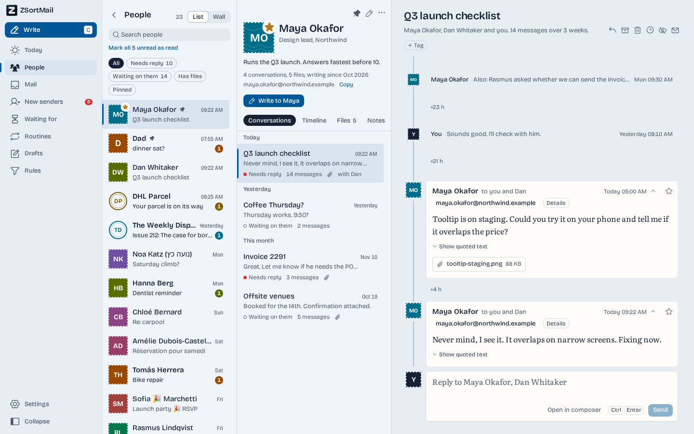
</p>

## What it is

Most mail clients give you one long list of messages. ZSortMail turns that around. Mail is filed under whoever wrote it, so you open a person and see everything between the two of you: the conversations, in order, the files they sent, and a notes tab that is yours. Open a conversation and it is drawn as a strand, with the gaps between replies shown as gaps, so a quick back and forth looks tight and a three-week silence looks like one.

Your mail is copied from Gmail into a database on your own computer. The app reads that copy, so it opens instantly and works offline. Changes are saved locally and sent to Gmail in the background. There is no ZSortMail server in the middle, nothing is sent anywhere except to Google, and the app never deletes mail for good: Trash moves it to Gmail's Trash, and removing an account only deletes the local copy.

It is pre-release software. It has been used every day on Linux, against real Gmail accounts. The Windows and macOS builds come out of CI but nobody has run them yet, so expect rough edges there and please tell us about them.

## A look around

<table>
  <tr>
    <td width="50%">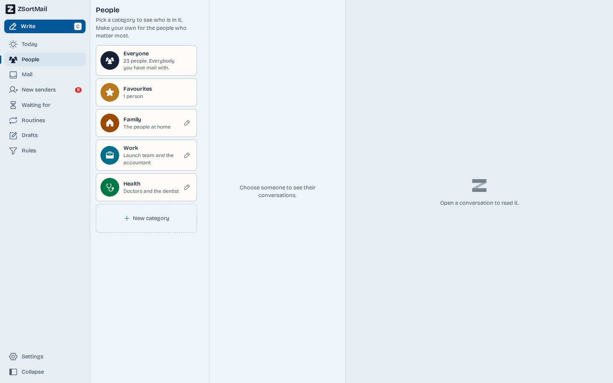</td>
    <td width="50%">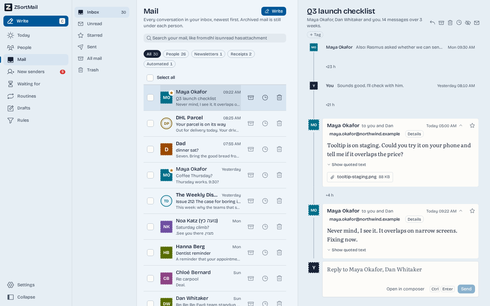</td>
  </tr>
  <tr>
    <td valign="top"><b>People, in categories.</b> Everyone is always there, plus Favourites and any categories you make: family, work, your doctor. Each has its own icon, colour and description.</td>
    <td valign="top"><b>Mail, the way a mail site looks.</b> Mailboxes and labels on the left, the list, and the message beside it. Big targets for select, snooze and archive.</td>
  </tr>
  <tr>
    <td>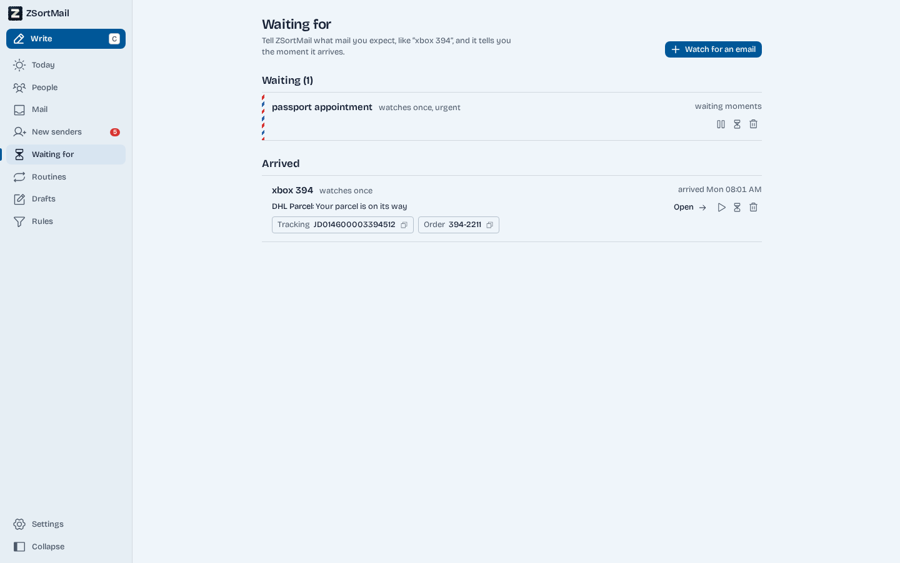</td>
    <td>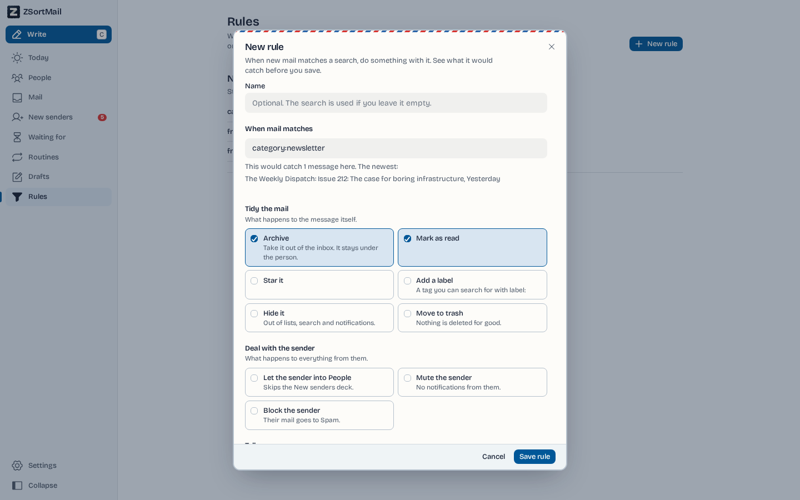</td>
  </tr>
  <tr>
    <td valign="top"><b>Waiting for.</b> Say what you are expecting, like "xbox 394". It tells you when it arrives and pulls out the tracking and order numbers.</td>
    <td valign="top"><b>Rules that show their work.</b> A rule says how many messages it would catch before you save it, applies to existing mail in one step, and can be undone in one step.</td>
  </tr>
  <tr>
    <td>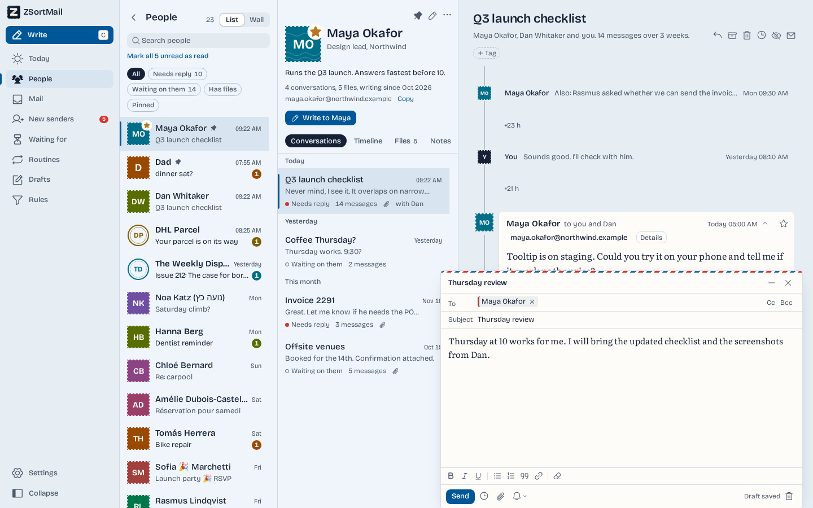</td>
    <td>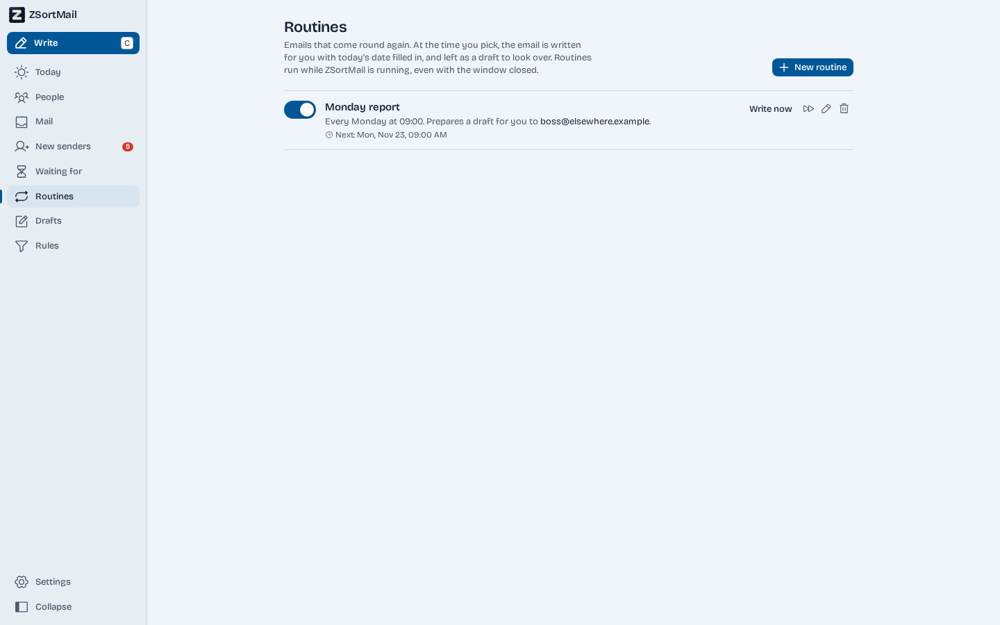</td>
  </tr>
  <tr>
    <td valign="top"><b>Writing.</b> Undo send, send later, a reminder if nobody answers, files by drag, paste or button.</td>
    <td valign="top"><b>Routines.</b> The same email every Monday, or whenever you press a button, with today's date filled in. It prepares a draft, or sends by itself if you allow it.</td>
  </tr>
  <tr>
    <td>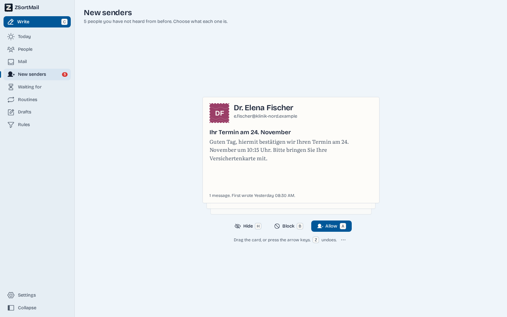</td>
    <td>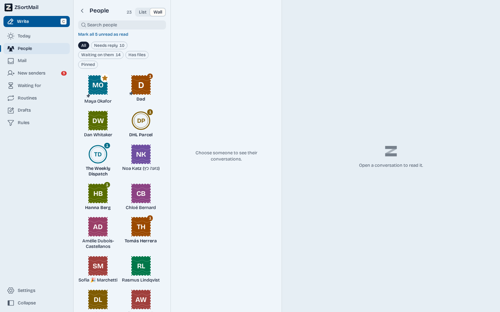</td>
  </tr>
  <tr>
    <td valign="top"><b>New senders.</b> Someone you have never heard from waits for a decision: allow, hide or block. Nothing from a stranger lands among your people by itself.</td>
    <td valign="top"><b>The wall.</b> Everyone as a stamp, if you would rather browse than read a list.</td>
  </tr>
  <tr>
    <td>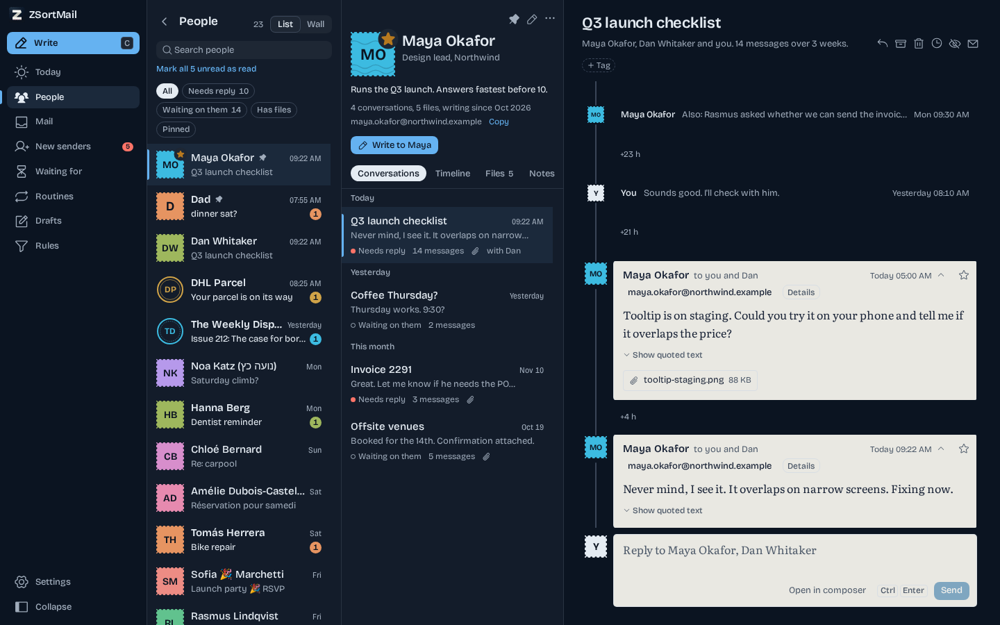</td>
    <td>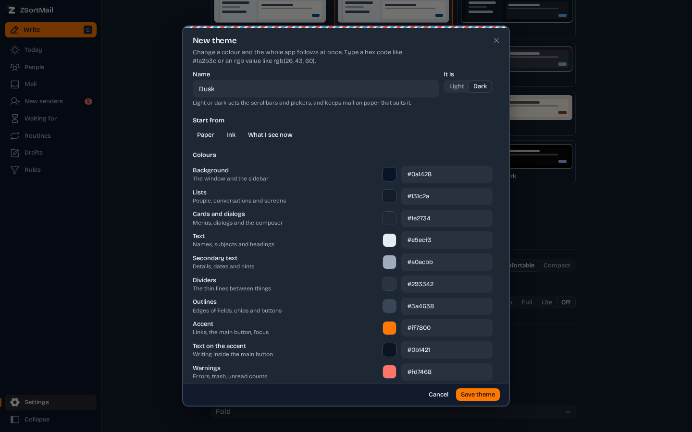</td>
  </tr>
  <tr>
    <td valign="top"><b>Eleven themes.</b> Light, dark, and a handful in between, each checked for contrast.</td>
    <td valign="top"><b>Make your own.</b> Type a hex or rgb value for the background, text, dividers and accent, see the whole app change as you type, and get a warning when two colours are hard to read together.</td>
  </tr>
</table>

## What it does

**People**

- A person is made from the mail itself. Services (a parcel company, a newsletter) get a round postmark instead of a stamp, so you can tell them apart at a glance.
- Pin people, star favourites (the star shows everywhere they appear), add notes, a role and a description.
- Categories with your own icon, colour, picture and description, and a name of your own for each person inside a category. A person can be in several.
- Merge two addresses into one person, or split one back off. Import an address book from a vCard file, or once from Google Contacts.

**Reading**

- The conversation is a strand. Quoted history is folded away, old read messages collapse to a line, and long threads stay quick.
- Read it as a clean letter or as the original HTML. HTML is cleaned when it arrives and shown in a sandbox that cannot reach the network or the app.
- Remote images are blocked until you allow them, tracking pixels are removed and counted, and a link whose text says one thing and goes somewhere else asks first.
- Every file a person has ever sent, in one place, with previews for images and PDFs. A timeline tab interleaves all the messages.
- Tags, snooze, and a Mail screen with mailboxes, labels, select-all and shift-click ranges.

**Writing**

- A rich-text composer with recipient suggestions, drafts that save themselves, reply, reply to all and forward.
- Undo send inside a window you choose, send later, and "remind me if nobody replies in three days".
- Routines: recurring or on-demand emails with variables such as the date and weekday. A routine you missed because the computer was asleep runs once, marked late, and will not send by itself if it is badly overdue.
- A Write button is always in the sidebar, and on every person.

**Sorting out the pile**

- Hide a message, a person or a whole domain, optionally for a while. Hiding is local.
- Block moves a sender's mail to Spam. Mute stops notifications from one person.
- Rules and saved searches share one search language, with a preview and undo.
- Newsletters, receipts and automated mail are told apart from people, and a one-click unsubscribe is checked before it is used.
- Undo works for nearly everything, fifty steps deep.

**Waiting for, and notifications**

- Watch for words, a sender or an attachment; once or for good; normal or urgent. It lists how long you have been waiting, and when it arrives it shows the tracking number, order number or reference it found.
- Quiet hours, a Focus mode that lets only favourites and watches through, and a log that says why each notification fired.

**Search**

One language everywhere: `from:maya has:attachment newer_than:30d`, `"launch checklist"`, `is:unread category:newsletter`, `person:maya`, `group:family`, `(from:dhl OR from:ups) is:unread`, `-subject:invoice`. It never gives an error; what it does not understand is treated as a word.

**Several accounts**

Link as many Gmail accounts as you like. Each is a profile with its own theme, density, animations, shortcuts and sidebar, or switch on one shared set. Lists, search, counts and the account you write from follow the profile you are in.

**Make it yours**

Hide, show and reorder the sidebar tabs and pin categories there. Drag any divider. Pick an animation for each kind of movement, or none. Four key sets (ZSortMail, Gmail, Superhuman, Vim) with any single key changeable. English and German. Compact or comfortable spacing. Its own title bar, so it looks the same on every system.

## Install

Installers for each system are on the [website](https://zsync.eu/zsortmail/) and on the Releases page when a version is tagged: an AppImage, deb and rpm for Linux, an installer for Windows (it installs for the current user, no administrator needed), and a dmg for macOS.

These builds are not signed yet, so each system will complain the first time:

- Windows: SmartScreen says the publisher is unknown. Press More info, then Run anyway.
- macOS: Gatekeeper refuses to open it. Right-click the app and choose Open, or run `xattr -dr com.apple.quarantine /Applications/ZSortMail.app` once.
- Linux: make the AppImage executable (`chmod +x ZSortMail_*.AppImage`) and run it, or install the deb or rpm. The window is drawn by WebKitGTK; it has been run on 2.54, and anything from the last couple of years should do.

macOS 12 or newer is needed. Windows 10 or 11 is needed; the app uses the Edge WebView2 runtime, which Windows 11 already has and the installer fetches for Windows 10.

Your data lives in `~/.local/share/dev.zsortmail.app` on Linux, `~/Library/Application Support/dev.zsortmail.app` on macOS and `%APPDATA%\dev.zsortmail.app` on Windows. Sign-in tokens are kept in the system keychain (Secret Service, Keychain, Credential Manager), not in that folder. To start over, quit the app and delete the folder.

## Connecting Gmail

Google only lets an app read Gmail through a client that its owner registers, and until this project has one that Google has reviewed, you make your own. It takes about ten minutes, costs nothing, and the two values it gives you never leave your computer. The app walks you through it the first time you press Link a Gmail account, with each page one click away. Here it is on paper.

<details>
<summary>The seven steps</summary>

1. Open <a href="https://console.cloud.google.com/projectcreate">Google's new project page</a>, sign in, name the project ZSortMail and press Create.
2. Turn on the <a href="https://console.cloud.google.com/apis/library/gmail.googleapis.com">Gmail API</a> and press Enable.
3. Open <a href="https://console.cloud.google.com/auth/overview">Google Auth Platform</a>, press Get started, call the app ZSortMail, use your own address as the support and contact email, choose External and create it.
4. Under <a href="https://console.cloud.google.com/auth/audience">Audience</a>, add the Gmail addresses you want to link as test users. Without this Google answers "access_denied".
5. Under <a href="https://console.cloud.google.com/auth/scopes">Data access</a>, add the scopes <code>openid</code>, <code>email</code>, <code>profile</code> and <code>https://www.googleapis.com/auth/gmail.modify</code>.
6. Under <a href="https://console.cloud.google.com/auth/clients">Clients</a>, create a client of type Desktop app. Any other type fails later.
7. Paste the Client ID and Client secret into ZSortMail, or paste the JSON file Google lets you download and both fill in. Then link the account.

When your browser opens Google it will say the app is not verified. That is expected for your own client: press Advanced, then Go to ZSortMail. Keep the Gmail box ticked on the permissions screen; without it nothing can sync, and ZSortMail will tell you if that happened. While the project is in Testing, Google asks you to sign in again about once a week, and ZSortMail shows a Link again button when it does.

</details>

<p align="center">
  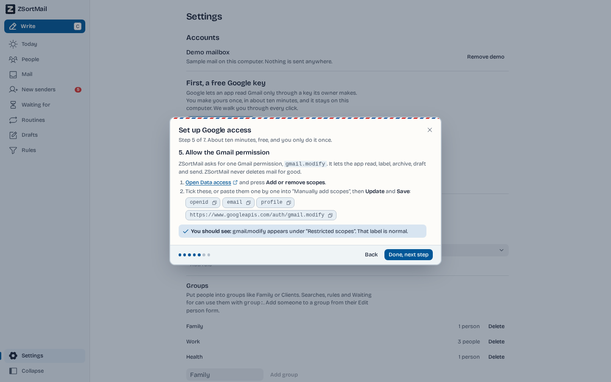
</p>

## Keyboard

| Key | Does                  | Key                 | Does                          |
| --- | --------------------- | ------------------- | ----------------------------- |
| `c` | New message           | `j` / `k`           | Next or previous conversation |
| `r` | Reply                 | `]` / `[`           | Next or previous person       |
| `a` | Reply to all          | `/`                 | Search and commands           |
| `f` | Forward               | `Ctrl` or `Cmd` `K` | Command palette               |
| `e` | Archive               | `Ctrl` or `Cmd` `Z` | Undo                          |
| `#` | Move to trash         | `Ctrl` or `Cmd` `B` | Hide or show the sidebar      |
| `h` | Hide                  | `u`                 | Mark unread                   |
| `s` | Snooze until tomorrow |                     |                               |

These are the default set. Settings has the Gmail, Superhuman and Vim sets and lets you change any one key.

## Building it yourself

You need Rust (stable, 1.90 or newer), Node 22.12 or newer, and pnpm (`corepack enable` picks up the right version from `package.json`). Then, depending on your system:

- Linux: the WebKitGTK and tray libraries. On Debian or Ubuntu that is `sudo apt install libwebkit2gtk-4.1-dev libayatana-appindicator3-dev librsvg2-dev libssl-dev patchelf build-essential`. On Arch it is `webkit2gtk-4.1`, `libayatana-appindicator`, `librsvg` and `base-devel`.
- Windows: the Visual Studio Build Tools with the "Desktop development with C++" workload, and the WebView2 runtime if you are on Windows 10.
- macOS: the Xcode command line tools (`xcode-select --install`).

```sh
git clone https://github.com/TheHolyOneZ/ZSortMail.git
cd ZSortMail
pnpm install

pnpm tauri dev            # run the app with live reload
pnpm tauri build          # make an installer for this system, in target/release/bundle
pnpm tauri build --no-bundle   # just the program, in target/release
```

To look around without a Google account, `pnpm dev:web` starts the real backend with a demo mailbox of invented people and serves the interface at http://localhost:1420 in your browser. Add `-- --people 5000` for a few thousand generated people.

The checks CI runs:

```sh
cargo fmt --all --check
cargo clippy --workspace --all-targets -- -D warnings
cargo test --workspace
pnpm lint && pnpm typecheck && pnpm test
pnpm exec playwright install chromium   # once
pnpm e2e
```

If you change a Rust type that the interface uses, run `pnpm bindings` so `src/lib/bindings.ts` follows.

### How the code is laid out

```
src/            the interface: React 19, TypeScript, Tailwind, TanStack Router and Query
src-tauri/      the desktop shell: window, tray, notifications, the zsm:// protocol
crates/
  zsm-core      the database, search language, rules, watches, routines, drafts
  zsm-mime      parsing, sanitising and building mail
  zsm-gmail     Google sign-in, the Gmail client, sync and the send queue
  zsm-app       the one service the shell and the test server both drive
  zsm-testkit   a pretend Google for tests
  zsm-devserver the real backend behind HTTP, for browser tests and pnpm dev:web
e2e/            browser tests against the demo mailbox and the pretend Google
```

## Contributing

Pull requests are welcome. [CONTRIBUTING.md](CONTRIBUTING.md) lists the few rules that are easy to break by accident (the licence, the design tokens, motion, wording, privacy). Security problems go through [SECURITY.md](SECURITY.md), not a public issue.

## Licence

ZSortMail is free software under the GNU General Public License, version 3 or any later version. See [LICENSE](LICENSE). It bundles the Bricolage Grotesque and Literata typefaces (SIL Open Font Licence) and uses Phosphor icons (MIT); the licences for everything else are tracked with `cargo deny` and the REUSE metadata in this repository.
